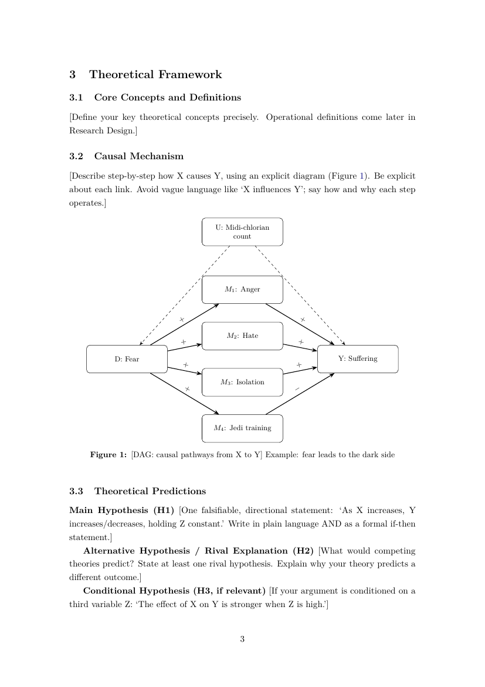
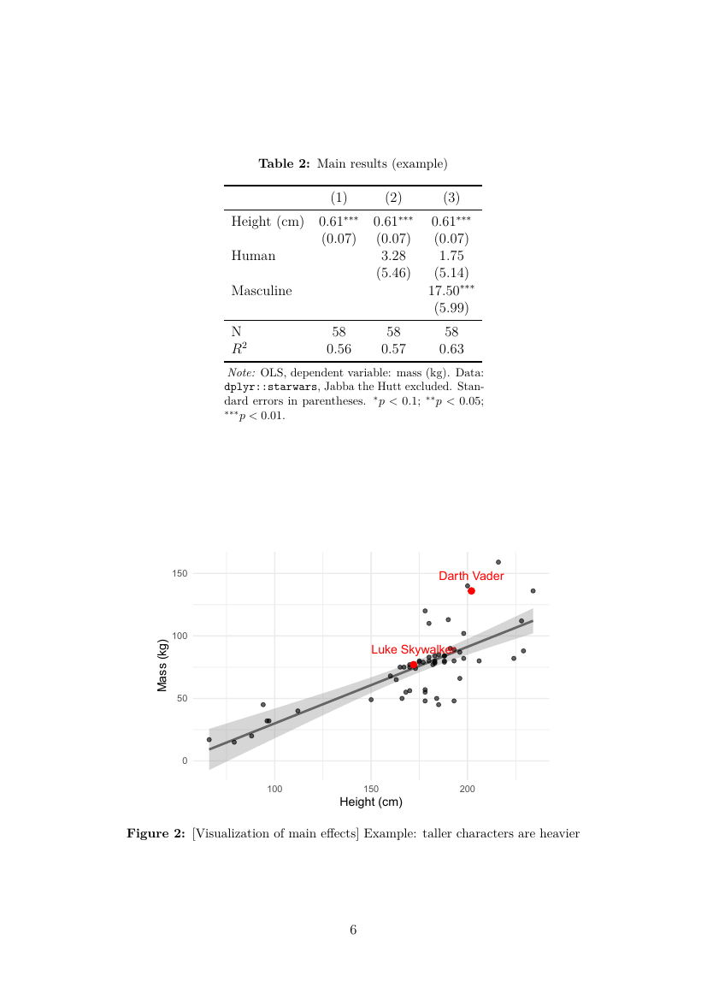
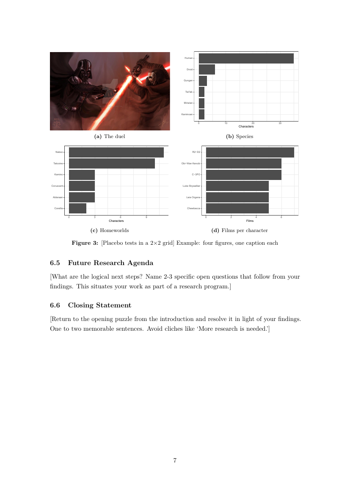

<!-- ===================================================================== -->
# Statement of Need {#sec-need}

Good practices for research code are well known: keep raw data read-only, number the scripts in execution order, pin package versions, use version control, and generate figures instead of pasting them [@wilson2017; @marwick2018]. They are also slow to set up, and the setup happens at the worst moment: the start of a project, when nothing seems at stake yet. So each project gets a different layout, or none.

`create.project` makes the good default the fast default. It targets social scientists who write R, and anyone who writes small R packages for fun (because we are dirty, single, and have some time to spend one way or another, right?). One call gives a project that a colleague, a reviewer, or the same person on another computer can rerun.

<!-- ===================================================================== -->
# State of the Field {#sec-field}

`usethis` [@usethis] provides the building blocks (create a package, add a license, add tests) but no research layout and no paper. `rrtools` [@marwick2018] turns a research project into a package (a "research compendium") with an R Markdown paper and Docker. `ProjectTemplate` [@projecttemplate] gives a data analysis layout. `workflowr` [@blischak2019] turns R Markdown analyses into a versioned website (@tbl-comparison).

`create.project` sits between them: research and package layouts behind one function, and a LaTeX paper rather than R Markdown. Users who write in R Markdown or Quarto are better served by `rrtools` or `workflowr`.

<!-- a Markdown table cannot shrink to the page width (it wraps the cells, and
     code names like ProjectTemplate overflow): the table is made in R instead.
     resize_direction = "down" does what adjustbox does in main.tex.
     cells are LaTeX, so _ is written \\_ and \ is written \\ -->
```{r}
#| label: tbl-comparison
#| tbl-cap: "Comparison with existing tools"
comparison <- data.frame(
  check.names = FALSE,
  " "                         = c("Research layout", "Package layout", "Paper", "Version pinning"),
  "\\texttt{create.project}"  = c("$\\checkmark$", "$\\checkmark$", "LaTeX", "\\texttt{renv}"),
  "\\texttt{usethis}"         = c("", "$\\checkmark$", "", ""),
  "\\texttt{rrtools}"         = c("$\\checkmark$", "$\\checkmark$", "R Markdown", "Docker"),
  "\\texttt{ProjectTemplate}" = c("$\\checkmark$", "", "", ""),
  "\\texttt{workflowr}"       = c("$\\checkmark$", "", "R Markdown", "")
)
tinytable::tt(comparison) |>
  tinytable::style_tt(j = 2:6, align = "c") |>
  tinytable::theme_latex(resize_direction = "down")
```

<!-- ===================================================================== -->
# Design {#sec-design}

Two exported functions (@fig-architecture). `create_project()` chooses a layout from `type`, then calls `create_paper()` with the matching paper type. `create_paper()` also works alone, in any project. @Tbl-layouts lists what each layout contains.

<!-- a figure written in LaTeX (TikZ): only shows up in the PDF -->
::: {#fig-architecture}

```{=latex}
\footnotesize
\begin{tikzpicture}[box/.style={draw, rounded corners, align=center, minimum width=3.2cm, minimum height=1cm},
                    result/.style={draw, dashed, align=center, minimum width=3.4cm, minimum height=1cm}]
    \node[box]    (cp)  at (0,0)     {\texttt{create\_project()}};
    \node[result] (res) at (5,1.2)   {research layout};
    \node[result] (pkg) at (5,-1.2)  {package layout};
    \node[box]    (pp)  at (10,0)    {\texttt{create\_paper()}};
    \node[result] (tex) at (10,-2.4) {\texttt{main.tex}\\\texttt{references.bib}};
    \node[result] (git) at (0,-2.4)  {first git commit};

    \tikzset{lab/.style={midway, fill=white, inner sep=1pt, font=\scriptsize\ttfamily}}
    \draw[-{Stealth}, thick] (cp)  -- node[lab] {"research"} (res);
    \draw[-{Stealth}, thick] (cp)  -- node[lab] {"package"}  (pkg);
    \draw[-{Stealth}, thick] (res) -- node[lab] {"research"} (pp);
    \draw[-{Stealth}, thick] (pkg) -- node[lab] {"software"} (pp);
    \draw[-{Stealth}, thick] (pp) -- (tex);
    \draw[-{Stealth}, thick] (cp) -- (git);
\end{tikzpicture}
```

Architecture: two beautiful functions and their outputs
:::

<!-- the last row spans both columns (colspan = 2), like \multicolumn in main.tex -->
```{r}
#| label: tbl-layouts
#| tbl-cap: "The two layouts"
layouts <- data.frame(
  check.names = FALSE,
  "\\texttt{type = \"research\"}" = c(
    "\\texttt{1\\_raw\\_data/} never edited by hand",
    "\\texttt{2\\_scripts/} numbered = run order",
    "\\texttt{3\\_derived\\_data/} regenerated",
    "\\texttt{4\\_outputs/} figures, tables",
    "\\texttt{5\\_docs/} research paper",
    "\\texttt{6\\_archives/} old material",
    "\\texttt{renv/} pinned package versions",
    "both: \\texttt{DESCRIPTION}, \\texttt{.Rproj}, \\texttt{LICENSE}, \\texttt{README.md}, ignore files, git"
  ),
  "\\texttt{type = \"package\"}" = c(
    "\\texttt{R/} all functions",
    "\\texttt{man/} generated documentation",
    "\\texttt{tests/testthat/} unit tests",
    "\\texttt{vignettes/} tutorial",
    "\\texttt{data-raw/} scripts that build \\texttt{data/}",
    "\\texttt{inst/CITATION}",
    "\\texttt{paper/} software paper",
    ""
  )
)
tinytable::tt(layouts) |>
  tinytable::style_tt(i = 8, j = 1, colspan = 2) |>
  tinytable::style_tt(i = 8, line = "t", line_width = 0.05) |>   # \midrule above "both"
  tinytable::theme_latex(resize_direction = "down")
```

<!-- ===================================================================== -->
# Usage {#sec-usage}

Install once, and keep `renv` libraries out of synced folders (OneDrive, Dropbox) with one line in the user `.Renviron`:

```r
remotes::install_github("SimonLabarthe/create.project")
usethis::edit_r_environ()   # add: RENV_PATHS_LIBRARY_ROOT=<local folder>
```

Then one call per project:

```r
library(create.project)

create_project("~/dir/your_project", title = "Why political sciences make people so happy?")
create_project("~/dev/your_project", type = "package")
create_paper("5_docs")          # only the paper, in an existing project
```

The research call writes the six folders, five numbered script templates, a paper and a first commit. The paper already contains a causal diagram, two tables and five figures (@fig-output); each is an example to replace.

<!-- layout-ncol=3: three figures in a row, each with its own (a), (b), (c) caption.
     main.tex also draws a frame around each page (\fbox): Markdown images have none -->
::: {#fig-output layout-ncol=3}

{#fig-page3}

{#fig-page6}

{#fig-page7}

Three pages of a freshly generated research paper, before any writing
:::

<!-- ===================================================================== -->
# Quality and Validation {#sec-quality}

22 `testthat` expectations cover both layouts, re-running on an existing project, the paper templates and the escaping of LaTeX special characters. `R CMD check` reports no errors, warnings or notes, and so does a package freshly generated with `type = "package"`. Both paper types compile without LaTeX warnings with `pdflatex` and `biber`. Everything was tested on Windows 11 with R 4.5.2.

<!-- ===================================================================== -->
# Limitations {#sec-limits}

Defaults (author, GitHub account) are mine: other users must pass them as arguments. macOS and Linux are untested. Papers are LaTeX only. I am not a developer, so I may have made some mistakes. But don't hurt me pls <3

<!-- ===================================================================== -->
# Conclusion {#sec-conclusion}

Good project structure is cheap once it is one function call away. `create.project` makes that call, and gives the paper a head start.

<!-- ===================================================================== -->
# Software Availability {.unnumbered}

- Repository: <https://github.com/SimonLabarthe/create.project>
- Version described: 0.3.0
- License: MIT
- Requirements: R, and a LaTeX distribution (e.g. TinyTeX) for the papers



# References {.unnumbered}

::: {#refs}
:::
